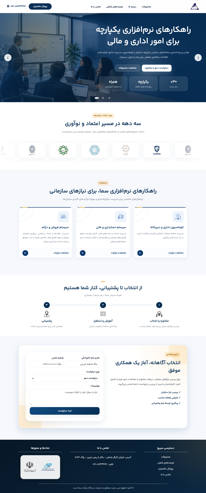
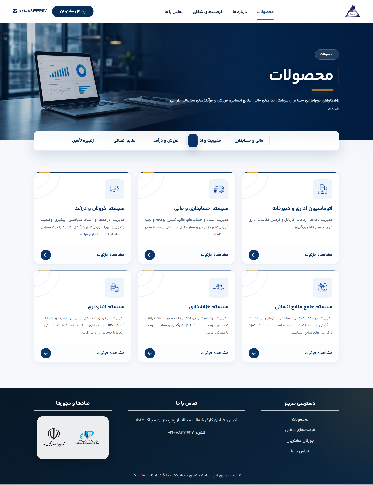
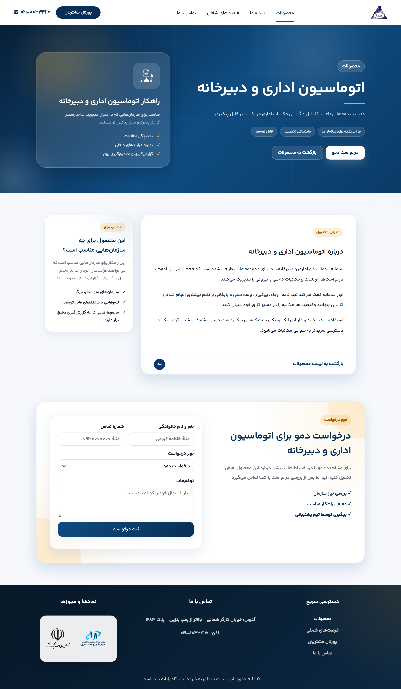
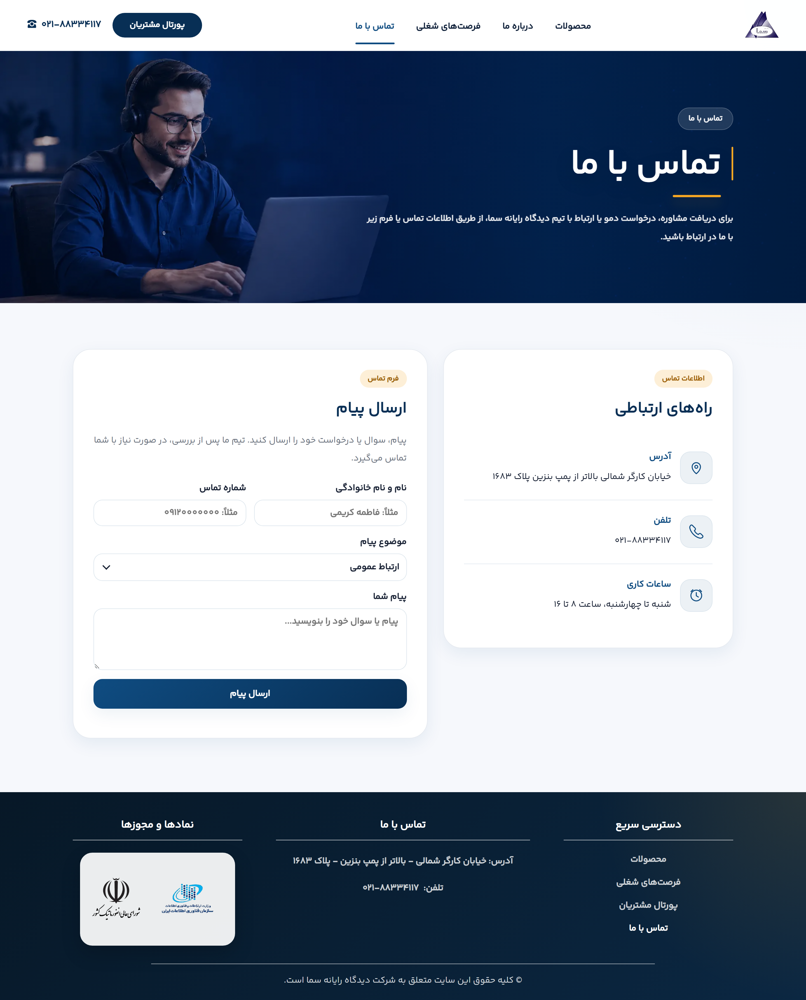
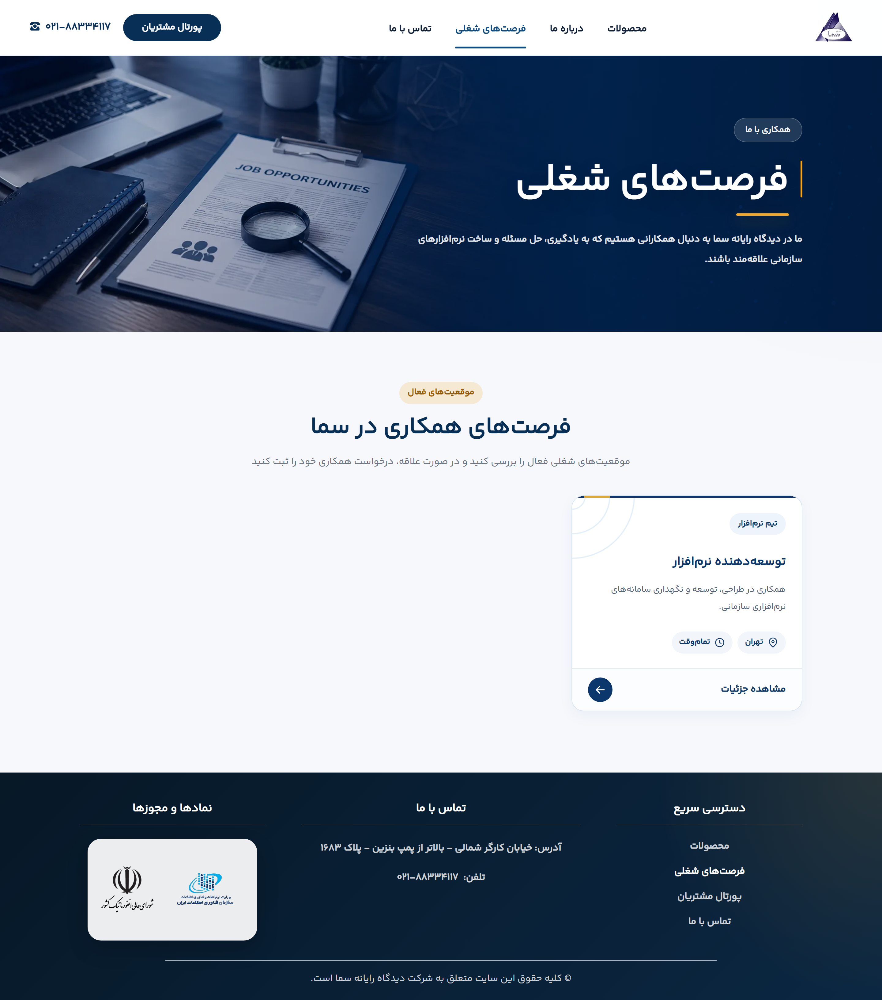
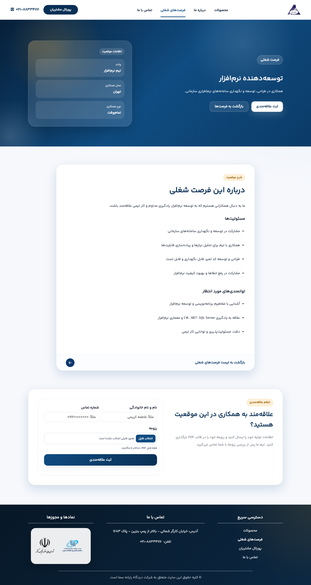
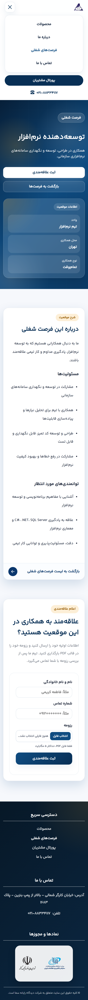
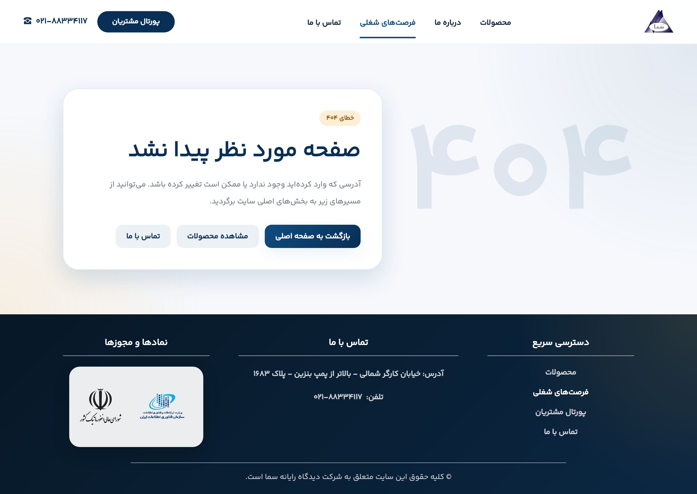

# DRS Corporate Website

[](https://github.com/FatemehAria/DRS-Umbraco/actions/workflows/ci.yml)

A production-oriented corporate website built with **Umbraco CMS**, **ASP.NET Core**, and **SQL Server**.

**Live website:** [drs.ir](https://drs.ir)

The project modernizes a WordPress/Elementor-based website into a maintainable .NET CMS application, while preserving compatibility with legacy form-submission data.

## Key Highlights

- CMS-managed content using Umbraco Backoffice
- Reusable Razor views and shared layouts
- Dynamic products, news, recruitment, and job-detail pages
- Persian RTL responsive interface and mobile navigation
- Custom ASP.NET Core endpoints for consultation and recruitment forms
- Integration with legacy Elementor submission tables during migration
- Customer portal gateway using YARP reverse proxy
- Anti-forgery protection, rate limiting, secure cookies, HSTS, and security headers
- SEO essentials: metadata, canonical URLs, `sitemap.xml`, `robots.txt`, and a custom 404 page
- GitHub Actions workflow for restore, build, and test validation

## Tech Stack

- ASP.NET Core / .NET
- Umbraco CMS
- SQL Server
- Razor Views
- HTML, CSS, and JavaScript
- PostCSS and Tom Select
- YARP Reverse Proxy
- IIS
- GitHub Actions

## Architecture

```text
Browser
  │
  ▼
IIS
  │
  ▼
ASP.NET Core + Umbraco CMS
  ├── Razor views and static assets
  ├── Custom form APIs
  ├── Customer portal gateway
  └── SEO and security middleware
  │
  ▼
SQL Server
  ├── Umbraco content database
  └── Legacy Elementor submission tables
```

## Features

### Content management

Non-technical editors can manage content through Umbraco Backoffice, including:

- Homepage sections
- Products and product details
- News and news details
- About and contact pages
- Recruitment opportunities and job details
- Custom 404 page content

### Forms and portal

- Consultation, contact, and recruitment request forms
- Server-side validation and anti-forgery validation
- Legacy WordPress/Elementor submission-table compatibility
- Customer portal sign-in gateway backed by an internal CRM service

### Security and SEO

- HTTPS and HSTS
- Secure, HttpOnly, and SameSite cookies
- Anti-forgery token validation for sign-in and forms
- Rate limiting for sign-in requests
- Security headers for content type, framing, referrer policy, and browser permissions
- `robots.txt`, `sitemap.xml`, canonical URLs, and custom 404 handling

## Local Development

### Prerequisites

- .NET SDK version required by the solution
- Node.js 22+
- SQL Server
- An Umbraco-compatible database configuration

### Configuration

Copy the safe configuration template and fill in local values:

```text
DrsUmbraco.Cms/appsettings.example.json
```

Do not commit connection strings, passwords, API credentials, HMAC keys, or production URLs.

### Run locally

```powershell
git clone https://github.com/FatemehAria/DRS-Umbraco.git
cd DRS-Umbraco\DrsUmbraco.Cms

npm ci

cd ..
dotnet restore .\DrsUmbracoPilot.slnx
dotnet run --project .\DrsUmbraco.Cms\DrsUmbraco.Cms.csproj
```

The local application normally runs on:

```text
http://localhost:26200
https://localhost:44398
```

Umbraco Backoffice:

```text
https://localhost:44398/umbraco
```

## Tests

Run automated tests, excluding tests that require local AI model files:

```powershell
dotnet test .\DrsUmbracoPilot.slnx --configuration Release --filter "Category!=Integration"
```

The GitHub Actions workflow validates dependency restore, frontend dependency installation, build, and tests for pushes and pull requests to `main`.

## Screenshots

### Homepage



### Products



### Product detail



### Contact page



### Recruitment page



### Recruitment Detail



### Mobile navigation



### Custom 404 page



## Project Scope

This repository contains the CMS website application, tests, documentation, and deployment-oriented configuration.

Experimental AI models, benchmark datasets, generated binaries, local credentials, and production configuration are intentionally excluded from source control.

## License

This repository is shared as a portfolio project. All rights reserved.

## Related Research

Chatbot evaluation scripts, benchmark datasets, and model experiments are maintained in the companion repository:

[DRS Umbraco Chatbot Research](https://github.com/FatemehAria/DRS-Umbraco-Chatbot-Research)